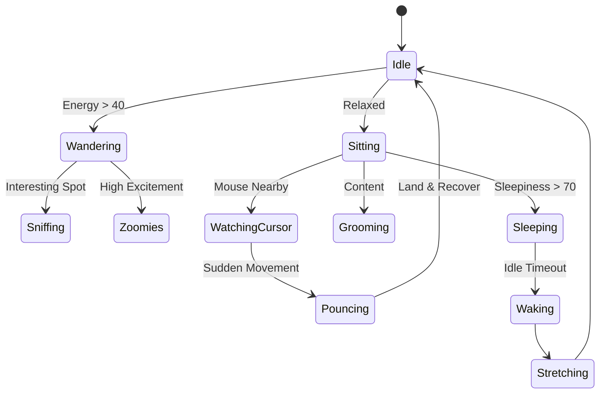

<div align="center">

# 🐱 Mochi — Desktop Cat Companion
### An Ultra-Cute, Living Windows Desktop Kitten

[](https://github.com/Kmrr-Gautam/Mochi-Cat)

<p align="center">
  
  
  
  
  
</p>

<p align="center">
  <strong>Mochi is not an animated wallpaper or a looping GIF.</strong><br/>
  Mochi is a tiny, living feline that shares your Windows desktop, wanders independently, chases toys,<br/>
  reacts to your cursor, takes naps while you work, and develops a unique personality.
</p>

[✨ Download Executable](#-download--run) • [🎮 Features](#-key-features) • [⌨️ Shortcuts](#%EF%B8%8F-global-shortcuts) • [🛠️ Architecture](#%EF%B8%8F-architecture--tech-stack) • [🚀 Development](#-quickstart--build)

</div>

---

[](https://github.com/Kmrr-Gautam/Mochi-Cat)

---

## 🌟 The Mochi Experience

Traditional virtual pets sit in a frame and wait for user commands. **Mochi flips this:**

- **Lives on your actual screen**: Mochi appears as a transparent, borderless overlay walking right across your taskbar, windows, and desktop icons.
- **Autonomous Brain**: Over 30 unique behavioral states (wandering, sneaking, tail-chasing, stretching, grooming, zoomies, window climbing, sniffing, and resting).
- **Smooth 2D Sprite Animation**: Built with high-performance **PixiJS** so character movement never causes React UI re-renders or high CPU consumption.
- **Offline & Private**: Never connects to the cloud. Zero account required. All personality and pet data is stored locally.

---

## 🎮 Key Features

### 1. 🐾 True Desktop Overlay
- Transparent window background without unsightly borders or dark halos.
- Multi-monitor support and high-DPI scaling for crisp 4K displays.
- Screen-edge collision and automatic recovery if displaced.
- Configurable **Click-Through Mode** allowing normal work without accidental clicks.

### 2. 🧠 Autonomous Cat Brain
Mochi makes independent, context-aware decisions driven by energy, mood, and curiosity:


### 3. 💖 Gaze Tracking & Petting
- **Eye & Head Tracking**: Mochi's feline pupils smoothly track cursor movement and tilt inquisitively.
- **Gentle Petting**: Slowly stroking over Mochi triggers squinting eyes, affectionate purrs, and floating hearts.
- **Rough Interaction Protection**: Rapid clicking makes Mochi leap backward, flatten its ears, and sulk safely with recovery timers.

### 4. 🎾 Interactive Toys & Physics
Spawn toys directly onto your screen with realistic bounce, gravity, and floor friction:
- 🧶 **Yarn Ball**: Rolls, unspools, and bounces off desktop edges.
- 🔴 **Laser Dot**: Scurries across the screen for fast pursuit.
- 📦 **Cardboard Box**: If it fits, Mochi sits!
- 🪶 **Feather Wand**, 🐭 **Plush Mouse**, 🐟 **Fish Toy**, 🛋️ **Soft Cushion**.

### 5. 💼 Cozy Work & Focus Modes
- **Work Mode**: Mochi settles near screen edges, naps frequently, and avoids critical taskbar buttons.
- **Focus Mode**: Mochi curls up into a silent sleep loop with zero audio and minimal resource usage.

### 6. 🎨 Pastel Bento Pet Room
A full React + Bento-Grid customization interface:
- **Cat Styling**: Fur color, calico patch color, eye color, and scale multiplier.
- **Dress-Up Accessories**: Cute bow, bell collar, flower crown, smart glasses, hoodie, witch hat, scarf, nightcap, and mini backpack.
- **Personality Archetypes**: *Playful*, *Cuddly*, *Curious*, *Sleepy*, *Chaotic*, *Shy*, or *Independent*.

---

## ⌨️ Global Shortcuts

| Shortcut | Action |
|:---|:---|
| <kbd>Ctrl</kbd> + <kbd>Shift</kbd> + <kbd>M</kbd> | Toggle Show / Hide Mochi |
| <kbd>Ctrl</kbd> + <kbd>Shift</kbd> + <kbd>C</kbd> | Toggle Click-Through Mode |
| <kbd>Ctrl</kbd> + <kbd>Shift</kbd> + <kbd>P</kbd> | Open Pet Room / Settings |

*You can also right-click the Mochi System Tray icon for treats, toy spawning, and mode toggles.*

---

## 🛠️ Architecture & Tech Stack

```
Mochi Cat/
├── src/
│   ├── main/                    # Electron main process
│   │   ├── index.ts             # App lifecycle & window manager
│   │   ├── managers/            # Settings, Tray, Overlay, Shortcuts, Bounds
│   │   └── ipc/                 # Secure IPC handler registration
│   ├── renderer/                # PixiJS Pet Overlay
│   │   ├── PetRenderer.ts       # PixiJS application entry
│   │   ├── PetStateMachine.ts   # 30+ autonomous behavior state machine
│   │   ├── EmotionEngine.ts     # Emotion decay & vitals engine
│   │   ├── MochiSpriteFactory.ts# Procedural 2D kitten vector rendering
│   │   ├── SpriteAnimationController.ts # Skeletal/procedural animator
│   │   ├── MouseInteractionController.ts# Petting & cursor physics
│   │   └── ToyPhysicsEngine.ts  # Gravity, bounce & friction physics
│   ├── settings/                # React Bento-Grid Pet Room
│   │   ├── SettingsApp.tsx      # Zustand & IPC state integration
│   │   └── components/          # PetRoomView, OnboardingView
│   ├── shared/                  # Types, constants & IPC definitions
│   └── preload/                 # Sandboxed contextBridge bridges
└── assets/                      # Icons, sounds, SVG artwork
```

---

## 🚀 Quickstart & Build

### Prerequisites
- Windows 10 or 11
- Node.js 18+ (tested up to Node 24)
- npm 9+

### 1. Clone & Install
```bash
git clone https://github.com/Kmrr-Gautam/Mochi-Cat.git
cd Mochi-Cat
npm install
```

### 2. Run in Development Mode
```bash
# Build main & renderer, then start Electron
npm start
```

### 3. Package Standalone Windows `.exe`
```bash
npm run pack
```
Your standalone executable will be generated at:
```
release/win-unpacked/Mochi Cat.exe
```

---

## 📦 Download & Run

You can run the portable standalone Windows executable directly without Node.js installed:

1. Download the latest release from the [Releases](https://github.com/Kmrr-Gautam/Mochi-Cat/releases) page.
2. Unzip and double-click **`Mochi Cat.exe`**.
3. Enjoy your new desktop companion!

---

## 📄 License

Distributed under the **MIT License**. See `LICENSE` for more information.

<div align="center">
  <sub>Made with 🐾 and care for cat lovers everywhere.</sub>
</div>
